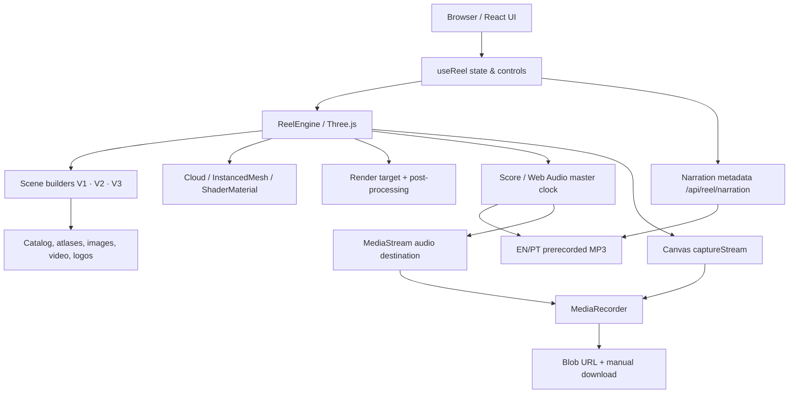

<div align="center">
  <p><strong>EDMUNDO KUTUZOV · MOTION ARCHIVE · 2026</strong></p>
  <h1>THE WORK MOVES.</h1>
  <h3>An interactive showreel. A living archive. A point of view.</h3>
  <p><strong>Built in Maputo. Made for the world.</strong></p>
  <p>
    <a href="https://showreel-kutuzov.vercel.app/"><strong>Explore the experience</strong></a>
    &nbsp;·&nbsp;
    <a href="https://edmundokutuzov.art/">Creative portfolio</a>
    &nbsp;·&nbsp;
    <a href="#06--quick-start">Run locally</a>
    &nbsp;·&nbsp;
    <a href="#04--architecture">Architecture</a>
  </p>
  <p>
    
    
    
    
    
    
  </p>
  <p><sub>Independent creative engineering · Real-time cinematic rendering · No fabricated campaign assets</sub></p>
</div>

---

> **O projecto, numa frase:** uma plataforma de apresentação audiovisual e exploração interactiva do trabalho de Edmundo Kutuzov. Combina um filme WebGL controlado por tempo, um arquivo 3D navegável, uma banda sonora procedural, narração bilingue e exportação local para vídeo — directamente no navegador.

**Estado de referência:** implementação da branch `main` observada em **11 de Novembro de 2026**, commit `2d77b028ed5fb5ce5af9883b1b7629952c2d17c7`. A produção na Vercel encontrava-se em estado `READY` nesse commit; este estado **não substitui** uma validação visual, funcional ou de qualidade do ficheiro exportado.

## Navigate

| Descobrir | Construir | Operar |
|---|---|---|
| [01 · Overview](#01--overview) | [04 · Architecture](#04--architecture) | [09 · Deployment](#09--deployment) |
| [02 · Experiences](#02--experiences) | [05 · Project structure](#05--project-structure) | [10 · Testing--qa](#10--testing--qa) |
| [03 · Final cut / V3](#03--final-cut--v3) | [06 · Quick start](#06--quick-start) | [11 · Troubleshooting](#11--troubleshooting) |
| [Visual direction](#visual-direction) | [07 · Assets--provenance](#07--assets--provenance) | [12 · Technical audit](#12--technical-audit) |
| [Interactive controls](#interactive-controls) | [08 · Audio--API](#08--audio--api) | [13 · Contribution--rights](#13--contribution--rights) |

## 01 · Overview

O **Showreel Kutuzov** não é um vídeo pré-renderizado colocado numa página web. É uma experiência audiovisual construída por código. O navegador recebe materiais de portfólio reais, carrega-os como texturas e media, e desenha cada momento num `canvas` WebGL de **1920 × 1080**. O utilizador pode reproduzir, interromper, procurar instantes na timeline, escolher versões, activar ou desactivar a voz, explorar as obras em 3D e preparar um ficheiro de vídeo.

| Dimensão | Implementação |
|---|---|
| Proposta | Showreel e arquivo interactivo de direcção de arte |
| Formato | 16:9 · 1920 × 1080 |
| Experiências | **V1:** 52 s · **V2:** 60 s · **V3:** 60 s |
| Versão inicial | V3, seleccionada em `useReel.js` |
| Arquivo | 155 entradas em `catalog.json`, incluindo 7 vídeos |
| Campanhas V3 | 6 colecções; 40 ficheiros originais publicados, 38 imagens únicas apresentadas |
| Outras obras V3 | 33 referências de catálogo na montagem de categorias |
| Marcas | 20 logótipos genuínos, apresentados separadamente das campanhas |
| Audio | Trilha sintetizada com Web Audio + narração EN/PT pré-gravada |
| Export | `canvas.captureStream(60)` + `MediaRecorder`; WebM ou MP4 conforme o navegador |
| UI | React, Tailwind CSS, tipografia Syne / Manrope / JetBrains Mono |
| Hosting | Vercel, com funções serverless para metadados de narração |

### Design principles

1. **Work first.** As peças do portfólio são a matéria-prima visual; o movimento deve valorizá-las.
2. **Motion with intention.** Cada corte, aceleração, pausa e transição pertence a uma timeline editorial.
3. **Real assets, real provenance.** As campanhas, logótipos e obras devem ser rastreáveis à sua origem.
4. **Interactive by design.** O filme não elimina a possibilidade de investigar os projectos em detalhe.
5. **Separate playback from mastering.** A gravação ao vivo é uma funcionalidade prática, não uma garantia de master frame-perfect.

### Visual direction

| Token | Valor | Aplicação |
|---|---|---|
| Background | `#0A0D15` | Fundo e atmosfera cinematográfica |
| Surface | `#121829` | Cartões / planos de suporte |
| Primary | `#4466FF` | Acções e energia cromática |
| Highlight / “ember” | `#9CC6F5` | Luz, indicadores e ênfase |
| Bone | `#E8EEF6` | Texto principal |
| Muted | `#8A94AB` | Informação secundária |
| Display | **Syne** | Editorial, títulos, massas tipográficas |
| Interface | **Manrope** | Leitura e navegação |
| Technical | **JetBrains Mono** | Timecodes, estados e microcopy |

Os valores do motor estão em `frontend/src/reel/core.js`; os tokens de interface estão em `frontend/src/App.css` e `frontend/src/index.css`. A composição inclui granulação, vinheta, aberração cromática, flashes, blur direccional, glitch e planos 3D, através de shaders em `post.js`.

## 02 · Experiences

### V1 — Editorial reconstruction · 52 s

Uma interpretação programada da primeira linguagem de motion, formada por uma sequência de **10 estudos editoriais** com imagens, tipografia, deslocações espaciais e cortes.

- Entrada: `buildEditorialStudy()` em `frontend/src/reel/editorialStudy.js`.
- Duração: `VINTAGE_DURATION = 52`.
- **Importante:** a V1 no site é uma **reconstrução**, **não** o MP4 histórico original. O ficheiro histórico referido em `MOTION_VERSIONS.md` não está alojado neste repositório.
- Não apresentar a V1 como restauração binária fiel, nem disponibilizar um suposto original sem verificar a sua origem.

### V2 — Original interactive · 60 s

A experiência WebGL preservada, com abertura tipográfica, expansão do arquivo, galáxia de trabalhos, índice por disciplina, sequências de campanha, marcas e assinatura.

**Builders activos na V2:** `buildVoid`, `buildArchive`, `buildCinema`, `buildCorridor`, `buildRush`, `buildClients` e `buildFinale`. O conjunto é construído por `ReelEngine.load()` em `frontend/src/reel/engine.js`.

### V3 — The final cut · 60 s

A versão seleccionada por defeito. Reutiliza literalmente `buildVoid()` e `buildArchive()` nos primeiros 21 segundos da V2 e depois passa para uma realização curada em `frontend/src/reel/campaignFilm.js`. O último plano apresenta a extrusão e animação do monograma **EK**; não escreve o nome completo no encerramento.

> **Source of truth:** para a V3, a tabela de sequências e os títulos efectivamente usados são `CAMPAIGN_FILM_SCENES`, `CAMPAIGNS`, `CATEGORIES` e `BRAND_NAMES` em `campaignFilm.js`. Documentos históricos e textos de UI podem reflectir revisões anteriores.

### Interactive controls

| Controlo | Comportamento |
|---|---|
| Versão 1 / 2 / 3 | Reconstrói o motor e selecciona outra timeline |
| Play / Pause | Inicia ou suspende imagem e áudio |
| Recomeçar | Reposiciona o relógio no início |
| Timeline | Procura um instante directamente |
| EN / PT / Sem voz | Alterna a narração ou mantém apenas instrumental e efeitos |
| Explorar arquivo | Substitui o filme por um arquivo 3D navegável |
| Arrastar / scroll | Roda a câmara e aproxima ou afasta no modo de exploração |
| Seleccionar uma obra | Abre ficha de media e ligação ao projecto no portfólio |
| Ecrã inteiro | Usa a Fullscreen API sobre o palco |
| Preparar vídeo 1080p | Grava a reprodução em tempo real |
| Descarregar agora | Descarrega o blob concluído, mediante clique explícito |

A interface principal vive em `frontend/src/pages/ReelStudio.jsx`. O estado de reprodução e as acções são orquestrados pelo hook `frontend/src/hooks/useReel.js`. A camada React está separada do motor Three.js.

## 03 · Final cut / V3

### Chapter map

| Intervalo | Capítulo | Descrição |
|---|---|---|
| 00:00–00:03.6 | V2 Intro | Manifesto cinético, escuridão e ruptura do ecrã |
| 00:03.6–00:21 | Galaxy & Index | Explosão de 155 entradas, galáxia e índice |
| 00:21–00:34.2 | Campaigns | Seis campanhas, em composições editoriais e grupos de peças |
| 00:34.2–00:45 | Visual practice | Social Media, Manipulation, Some Dezaines+ e Video |
| 00:45–00:53.5 | Brands | 20 marcas em cinco grupos de quatro |
| 00:53.5–01:00 | EK 3D | Monograma oficial extrudido, iluminação e movimento contínuo |

### Six real campaigns

| Intervalo | Projecto | Cliente identificado | Ficheiros publicados | Apresentados |
|---|---|---|---:|---:|
| 21.0–23.2 s | A Depressão é Real | ICOR | 14 | 12 |
| 23.2–25.4 s | Diga YES & Viva o Mundo Online | Webmasters | 9 | 9 |
| 25.4–27.6 s | Cozinhar é Arte | Pembe Moz | 1 | 1 |
| 27.6–29.8 s | Água é Vida e Você é 100% Água | Fonte Fresca | 3 | 3 |
| 29.8–32.0 s | Viva a Experiência no Super Marés | Super Marés | 7 | 7 |
| 32.0–34.2 s | We Are GIZ | GIZ | 6 | 6 |
| **Total** | **6 colecções** | | **40** | **38** |

Os 40 ficheiros mantêm-se armazenados. A montagem ignora os índices `11` e `13` da colecção ICOR para evitar repetição visual, sem apagar os originais. As categorias seguintes apresentam **33 selecções de catálogo** em conjuntos de três; não reutilizam projectos de categoria `CAMPAIGN`.

**Atenção às revisões criativas:** a implementação auditada apresenta o texto `SOME DEZAINES+` e um único ficheiro em `cozinhar-arte`. Se existir uma revisão editorial aprovada com outra grafia ou uma segunda arte, essa alteração tem de ser efectivamente aplicada ao código e ao manifesto antes de ser descrita como publicada.

### The EK signature

`frontend/src/reel/brandMark.js` converte três polígonos do símbolo oficial EK em `THREE.ExtrudeGeometry`. O final de `campaignFilm.js` combina geometria, material metálico, luzes ambiente/pontuais, duplicação subtil do símbolo, anéis, partículas e câmara orbital. O objectivo é preservar a identidade do logótipo, não fabricar uma marca alternativa.

## 04 · Architecture



### Layer responsibilities

| Camada | Fonte | Responsabilidade |
|---|---|---|
| Bootstrap | `src/index.js`, `src/App.js` | React root, providers e rota `/` |
| Studio | `src/pages/ReelStudio.jsx` | Layout, escolha de versão e secções editoriais |
| UI controls | `src/components/reel/*` | Palco, timeline, narração, exploração e export |
| State orchestration | `src/hooks/useReel.js` | Estado, motor, recursos, reprodução, erros, idiomas |
| Engine | `src/reel/engine.js` | WebGL renderer, cenas, relógio, render loop, modos, gravação |
| Visual primitives | `src/reel/core.js` | Easing, tipografia em textura, geometria e utilitários |
| Scene choreography | `src/reel/{intro,archive,cinema,outro,campaignFilm,editorialStudy}.js` | Capítulos e animações |
| 3D archive | `src/reel/{cloud,formations,explore}.js` | Atlas instanciados, composição espacial, picking |
| Post effects | `src/reel/post.js` | Shader de pós-processamento |
| Audio score | `src/reel/audio.js` | Instrumental procedimental, VO, compressão, captura |
| Asset pipeline | `src/reel/assets.js` | Catálogo, texturas, vídeos, marcas e galerias |
| Same-origin API | `frontend/api/reel/*` | Metadados de voz e redirects para MP3 local |
| Optional backend | `backend/{server,reel}.py` | API FastAPI separada, MongoDB e TTS legado |

### The render pipeline

1. O motor cria um `WebGLRenderer` com dimensão fixa **1920 × 1080** e um `WebGLRenderTarget` com multisampling.
2. Os assets são carregados para texturas, texturas de vídeo, atlas e grupos de cena.
3. Cada builder expõe limites `start` e `end` e uma função `update(u, t, ctx)`.
4. O tempo de reprodução deriva do `AudioContext` via `Score.time()`; a timeline pode ser reposicionada com `seek()`.
5. A cada frame activo, o motor actualiza apenas as cenas em execução, posiciona objectos/câmara, desenha a cena 3D e aplica o shader de pós-processamento.
6. Em `explore`, o motor suspende a linguagem de filme e actualiza a câmara orbital, o picking por raycast e o arquivo.
7. Em exportação, a saída visual e a saída de áudio convergem para um `MediaRecorder`.

**Nota de precisão:** o `captureStream(60)` solicita 60 fps; isso não garante 60 frames distintos por segundo. A entrega depende do GPU, do compositor, do dispositivo, do navegador e da carga do sistema.

### Important engineering invariants

- A duração declarada e os tempos dos builders devem coincidir.
- A V3 tem de conservar o arranque V2 de 0 a 21 s.
- O manifesto das campanhas tem de conter 6 campanhas e 40 frames.
- A selecção activa da V3 deve ter 38 artes de campanha únicas e 33 referências de categoria sem duplicação de IDs ou slugs.
- Os 20 logótipos devem corresponder à ordem de `BRAND_NAMES`.
- Os clips de voz têm índices `0..10` para `en` e `pt`.
- A mudança de versão deve libertar o motor anterior e recriar o estado correctamente.
- Nunca apresentar a conclusão de uma gravação antes de existir um blob de vídeo não vazio.

## 05 · Project structure

```text
showreel-kutuzov/
├── README.md                          # documentação principal
├── MOTION_VERSIONS.md                 # notas históricas das versões
├── frontend/
│   ├── api/reel/
│   │   ├── narration.js               # linhas / timings / idiomas
│   │   └── vo/[lang]/[idx].js          # redirect para MP3 estático
│   ├── public/
│   │   ├── index.html
│   │   └── reel/
│   │       ├── catalog.json           # 155 obras
│   │       ├── atlas0.webp
│   │       ├── atlas1.webp
│   │       ├── img/                   # obras individuais em WebP
│   │       ├── vid/                   # 7 clips MP4 (148–154)
│   │       ├── logos/                 # 20 marcas
│   │       ├── campaigns/
│   │       │   ├── manifest.json
│   │       │   └── <slug>/*.webp       # 40 artes de campanha
│   │       └── vo/{en,pt}/            # 11 MP3 por idioma
│   ├── src/
│   │   ├── App.js
│   │   ├── pages/ReelStudio.jsx
│   │   ├── hooks/useReel.js
│   │   ├── components/reel/
│   │   ├── components/ui/             # biblioteca visual reutilizável
│   │   └── reel/                      # motor, builders, shaders, áudio
│   ├── plugins/health-check/          # health endpoints opcionais em dev
│   ├── craco.config.js
│   ├── tailwind.config.js
│   ├── package.json
│   └── yarn.lock
├── backend/
│   ├── server.py                       # FastAPI + MongoDB
│   ├── reel.py                         # TTS legado / cache local
│   ├── requirements.txt
│   └── tests/test_reel_api.py
├── scripts/
│   ├── import-campaign-artworks.cjs
│   ├── campaign-sources.json
│   └── campaign-asset-checksums.json
├── memory/PRD.md                       # contexto histórico, não contrato actual
├── test_reports/                       # relatórios históricos
└── test_result.md                      # relatório histórico
```

Os directórios `components/ui` contêm primitives reutilizáveis, predominantemente baseadas em Radix UI. Não são todos caminhos activos da experiência cinematográfica; preservar essa distinção na manutenção reduz alterações desnecessárias.

## 06 · Quick start

### Requirements

- **Node.js** compatível com React Scripts 5 / CRACO 7; o projecto Vercel estava configurado com **Node.js 26.x** quando foi inspeccionado. Alinhar as versões local e de CI com a efectiva versão de produção.
- **Yarn Classic 1.22.22** declarado em `frontend/package.json`. É preferível usar `corepack` e respeitar `yarn.lock`.
- Navegador actualizado com **WebGL**, **Web Audio**, Canvas e APIs modernas de media.
- Para o backend opcional: **Python 3**, dependências de `backend/requirements.txt` e MongoDB acessível.

### Frontend

```bash
git clone https://github.com/edmundokutuzov333/showreel-kutuzov.git
cd showreel-kutuzov/frontend

corepack enable
corepack yarn install --frozen-lockfile
corepack yarn start
```

Abrir **http://localhost:3000**. A interface WebGL e os assets locais podem arrancar sem um servidor Python; no entanto, **a API de narração `/api/reel/narration` não é criada automaticamente pelo servidor de desenvolvimento CRA**. Para narração durante desenvolvimento local, configurar o backend FastAPI ou uma estratégia local compatível com as funções Vercel.

### Frontend environment

Criar `frontend/.env.local` a partir de `frontend/.env.example`:

```dotenv
# Se vazio, o frontend tenta usar /api no mesmo domínio.
REACT_APP_BACKEND_URL=http://localhost:8000
```

**Não** colocar tokens privados em variáveis `REACT_APP_*`: estas são embebidas no bundle público do navegador. Se não existir backend, deixar a variável vazia; a banda sonora procedural continua funcional e a UI apresenta fallback quando a narração falha.

### Optional FastAPI development

O backend é um serviço **separado**, não o backend de produção que a configuração Vercel demonstra servir. Se for necessário reproduzir o percurso Python/TTS:

```bash
python3 -m venv .venv
source .venv/bin/activate
python -m pip install -r backend/requirements.txt

# Criar backend/.env com os valores fornecidos pela infraestrutura.
# Depois:
cd backend
uvicorn server:app --reload --port 8000
```

Exemplo de **nomes de variáveis**, sem valores reais:

```dotenv
MONGO_URL=<mongodb-connection-string>
DB_NAME=<database-name>
CORS_ORIGINS=http://localhost:3000
EMERGENT_LLM_KEY=<server-side-tts-credential>
```

`MONGO_URL` e `DB_NAME` são obrigatórias na importação de `backend/server.py`; `EMERGENT_LLM_KEY` é usada quando `backend/reel.py` precisa de gerar um MP3 ausente do cache. Nunca colocar estes valores em Git nem no frontend. Para Windows, adaptar a activação do ambiente virtual.

### Build

```bash
cd frontend
CI=true corepack yarn build
```

O comando usa `craco build`. Os resultados de produção são gerados em `frontend/build`. Não confundir o build estático com uma renderização offline de um vídeo final.

## 07 · Assets & provenance

### Repository asset model

| Conjunto | Localização | Papel |
|---|---|---|
| Catálogo | `public/reel/catalog.json` | IDs, títulos, slug, categorias, atlas, célula, formato |
| Atlas | `public/reel/atlas{0,1}.webp` | Visão global optimizada do arquivo 3D |
| Stills | `public/reel/img/{000..147}.webp` | Obras individuais |
| Motion | `public/reel/vid/{148..154}.mp4` | Clips curtos na montagem e na exploração |
| Campanhas | `public/reel/campaigns/<slug>/*.webp` | Galerias editoriais reais |
| Manifesto | `public/reel/campaigns/manifest.json` | Ordem e caminhos das 40 artes |
| Marcas | `public/reel/logos/*` | Logótipos de 20 marcas |
| Vozes | `public/reel/vo/{en,pt}/{0..10}.mp3` | 22 masters MP3 locais |
| Origem | `scripts/campaign-sources.json` | Páginas e URLs de fonte das campanhas |
| Integridade | `scripts/campaign-asset-checksums.json` | Hashes SHA-256 e tamanhos registados |

O carregamento ocorre em `frontend/src/reel/assets.js`. A integração usa `THREE.Texture`, `THREE.VideoTexture`, dois atlas e `THREE.InstancedMesh` para gerir o arquivo espacial. As imagens de campanha são guardadas em WebP com composição preservada e sem criar artes substitutas.

### Reproducible campaign import — caveat

Existe um script de importação em `scripts/import-campaign-artworks.cjs`. Ele valida domínio HTTPS numa whitelist, lê as galerias publicadas, confirma contagens, converte imagens para WebP e emite manifesto, origens e checksums.

**Este script não está actualmente pronto a executar em qualquer máquina sem adaptação:** importa `sharp` a partir de `/tmp/ek-image-tools/node_modules/sharp`, um caminho específico do ambiente em que foi criado. Também depende da estrutura HTML exacta da página publicada. Antes de reutilizar o importador, declarar `sharp` como dependência de projecto, remover o caminho absoluto, testar a extracção de galerias e rever permissões dos media.

### Updating the curation

1. Confirmar os direitos e a proveniência da obra.
2. Adicionar media com ID, nome, formato e dimensões consistentes.
3. Actualizar o catálogo, manifesto e/ou listas de selecção da cena apropriada.
4. Preservar a ordem de origem e a correspondência entre logótipos e nomes.
5. Rever `selectedDevelopmentAssets()` e ajustar testes somente quando os novos requisitos forem aprovados.
6. Validar visualmente **cada** entrada: enquadramento, legibilidade, duração e risco de repetição.
7. Regenerar hashes de integridade após alterações aprovadas e manter o registo de origem.

**Não** actualizar um número de artes apenas no texto da interface: os assets, a montagem, o manifesto e os testes têm de concordar entre si.

## 08 · Audio & API

### Score design

`Score` em `frontend/src/reel/audio.js` gera uma composição via Web Audio: kicks, hats, sub-bass, synth pads, impactos, risers, whooshes e acentos por capítulo. A V3 tem uma estrutura rítmica própria, programada em **120 BPM**. O áudio passa por ganho principal, compressão e um `MediaStreamAudioDestinationNode`, que alimenta a gravação.

A narração utiliza clips MP3 **pré-renderizados**; não há síntese de voz na reprodução Vercel. A selecção `Sem voz` desactiva a locução e mantém a música e os efeitos.

### Production / same-origin functions

| Método / rota | Resultado |
|---|---|
| `GET /api/reel/narration?lang=en&version=v3` | Linhas, tempos, URLs de MP3 e metadados |
| `GET /api/reel/narration?lang=pt&version=v2` | Cue sheet de 11 falas em português |
| `GET /api/reel/vo/en/0.mp3` | Redirect 307 para `/reel/vo/en/0.mp3` |
| `GET /reel/vo/pt/10.mp3` | Ficheiro MP3 estático |
| `GET /api/reel/narration?lang=fr` | 404, idioma não suportado |

`frontend/api/reel/narration.js` devolve **11 cues** para V1/V2 e, para V3, uma selecção curta de **3 cues** com referências aos índices dos MP3 originais. Uma alteração de texto sem regravar o MP3 correspondente criará divergência entre voz e copy.

Exemplo abreviado da resposta V3:

```json
{
  "lang": "en",
  "version": "v3",
  "voice": "en-US/joe",
  "model": "piper-medium/pre-rendered",
  "lines": [
    {"i": 0, "t": 3.7, "text": "Built in Maputo. Made for the world.", "url": "/reel/vo/en/2.mp3"},
    {"i": 1, "t": 35.0, "text": "Clarity. Rhythm. Precision. Memory.", "url": "/reel/vo/en/8.mp3"},
    {"i": 2, "t": 55.1, "text": "Just a creative guy.", "url": "/reel/vo/en/10.mp3"}
  ]
}
```

As vozes foram identificadas na documentação do repositório como Piper `en_US-joe-medium` e `pt_PT-tugão-medium`. Rever as licenças e os termos dos modelos e dos materiais derivados antes de distribuir comercialmente os masters.

### Legacy Python endpoints

O serviço `backend/reel.py` expõe rotas equivalentes de narração e geração TTS sob `/api/reel/*`, mas **não tem o mesmo contrato em todos os detalhes**: não implementa a selecção de cues por versão e pode gerar áudio através de um serviço externo. Os testes Python presentes em `backend/tests` exercitam esse percurso legado e não são prova de cobertura das funções Vercel.

## 09 · Deployment

### Verified production state · 11 Nov 2026

| Campo | Estado observado |
|---|---|
| Hosting | Vercel, projecto `showreel-kutuzov` |
| Framework | Create React App |
| Node configurado | `26.x` |
| Branch do último deploy | `main` |
| Commit | `2d77b028ed5fb5ce5af9883b1b7629952c2d17c7` |
| Deployment | `dpl_uoJ3za37fXHk8RFQVctpDhohQfeu` |
| Estado na API Vercel | **READY** |
| Alias de produção | [showreel-kutuzov.vercel.app](https://showreel-kutuzov.vercel.app/) |
| Origem | Deploy a partir do GitHub |

[Ver o deployment no painel Vercel](https://vercel.com/kutuzov/showreel-kutuzov/uoJ3za37fXHk8RFQVctpDhohQfeu)

Os dados acima são um **snapshot** da auditoria, não um widget de estado contínuo. Os project settings expostos pela integração não confirmaram todos os overrides de build/root directory. Para uma configuração reproduzível, verificar no painel que:

- **Root Directory:** `frontend`;
- **Framework Preset:** Create React App;
- **Install command:** instalação compatível com Yarn Classic e `yarn.lock`;
- **Build command:** `yarn build`, que executa `craco build`;
- **Output directory:** `build`, relativo a `frontend`;
- **API functions:** rotas em `frontend/api` disponíveis no deploy final;
- **Environment:** não configurar `REACT_APP_BACKEND_URL` para uma origem externa por engano;
- **Git:** branch de produção e política de preview/deploy correspondem à política da equipa.

**READY** confirma que a Vercel concluiu o deploy, mas não garante que WebGL, a API, todos os MP3, os vídeos, o botão de download ou os efeitos estejam correctos em todos os browsers. O acesso HTTP público e uma reprodução end-to-end não foram confirmados nesta auditoria. Não foi efectuado novo deploy de produção por esta documentação.

### Release discipline

```text
feature/docs branch
        │
        ▼
static review → unit tests → build → manual GPU/browser QA
        │
        ▼
pull request + review
        │
        ▼
merge into main (quando aprovado)
        │
        ▼
Vercel production deploy
        │
        ▼
smoke test + export verification + rollback readiness
```

Antes de promover uma versão, comparar a V3 visualmente com a V2, confirmar os 60 segundos completos, testar a narração nas três opções e inspeccionar o ficheiro exportado. Usar o histórico de deployments da Vercel como mecanismo de referência para rollback; não assumir que a existência de um deploy `READY` dispensa testes.

## 10 · Testing & QA

### Tests available

```bash
cd frontend

CI=true corepack yarn test --watch=false --runInBand
CI=true corepack yarn build
```

| Teste | Ficheiro | Validação |
|---|---|---|
| `versions.test.js` | `src/reel/` | 52 s da V1, abertura original da V2 na V3, 60 s |
| `curation.test.js` | `src/reel/` | Integridade das galerias, unicidade, categorias, marcas, EK |
| `voices.test.js` | `src/reel/` | Presença e cabeçalhos MP3 em EN/PT |
| Testes Python | `backend/tests/test_reel_api.py` | Endpoints de narração e TTS do backend legado |

Para os testes Python, levantar previamente o backend e definir `REACT_APP_BACKEND_URL` para a sua origem, por exemplo:

```bash
REACT_APP_BACKEND_URL=http://localhost:8000 python -m pytest backend/tests/test_reel_api.py -q
```

Os resultados em `test_reports/` e `test_result.md` são **históricos** e não substituem a execução sobre o commit actual. Esta revisão de documentação **não executou** os testes ou o build: não declarar uma suite “verde” sem os comandos e os logs da execução.

### Manual acceptance matrix

| Cenário | Critério de aceitação |
|---|---|
| First load | Sem falha de assets; WebGL disponível; progresso termina |
| V1 | Reconstrução com 52 s, identificada correctamente |
| V2 | Galáxia, índice e restantes capítulos completos |
| V3 | Início V2 preservado; seis campanhas; quatro categorias; marcas; EK |
| Scrubbing | Seek antes, durante e depois dos limites de cada cena |
| Audio | EN, PT, Sem voz, pausa/recomeço e transições |
| Explore | Arrastar, zoom, filtros, selecção e ligação para obra |
| Responsive | UI utilizável em desktop e mobile; composição 16:9 não cortada |
| Keyboard / accessibility | Operações essenciais acessíveis; foco visível |
| GPU performance | Sem crashes, context loss ou stutter impeditivo |
| Export | Ficheiro descarregável, visual e áudio completos, duração correcta |
| Network | Assets e endpoints sem 404; cache coerente |
| Observability | Sem erros críticos na consola, logs ou network waterfall |

### Export verification

A gravação é feita **em tempo real** e exige que o separador permaneça activo. O navegador escolhe o content type suportado: normalmente **WebM** em Chrome/Edge e, quando disponível, **H.264/AAC em MP4** no Safari. O nome do ficheiro codifica versão e idioma.

Depois de descarregar, verificar media e duração:

```bash
ffprobe -v error -show_entries format=duration,size \
  -show_entries stream=index,codec_type,codec_name,width,height \
  -of json edmundo-kutuzov-v3-en-16x9.webm
```

Substituir o nome e a extensão pelo ficheiro real. Confirmar vídeo **1920 × 1080**, duração próxima de 60 s para V2/V3 ou 52 s para V1, track de áudio audível e qualidade de frames. Para entrega publicitária ou arquivo definitivo, considerar renderização offline determinística e mastering externo.

## 11 · Troubleshooting

<details>
<summary><strong>O ecrã fica a carregar indefinidamente</strong></summary>

Verificar WebGL/GPU, erros de rede, fontes remotas e todos os caminhos de `/reel/*`. `loadAssets()` carrega em paralelo campanhas, atlas, media e logótipos; uma imagem obrigatória que falhe pode impedir `ready`. Verificar também a presença das seis campanhas e dos 40 frames esperados.
</details>

<details>
<summary><strong>O filme tem som, mas não tem voz</strong></summary>

O instrumental é gerado localmente. A narração exige `/api/reel/narration` e os MP3. Em `yarn start`, a função Vercel não é automaticamente servida pelo CRA: usar o backend configurado ou um ambiente de desenvolvimento que disponibilize a API. Confirmar `REACT_APP_BACKEND_URL`, CORS, status das respostas e carregamento de áudio.
</details>

<details>
<summary><strong>O vídeo gravado tem quebras ou duração incorrecta</strong></summary>

Manter o separador visível, fechar aplicações pesadas, reduzir carga de GPU e testar outro navegador. `MediaRecorder` capta frames reais durante a reprodução, sem garantias de frame stepping determinístico. Não usar um ficheiro com frames perdidos como master aprovado.
</details>

<details>
<summary><strong>MP4 não aparece como opção</strong></summary>

O código negocia formatos via `MediaRecorder.isTypeSupported()`. WebM pode ser o formato correcto para o navegador. Não mudar apenas a extensão do ficheiro; transcodificar posteriormente e inspecionar codecs e áudio.
</details>

<details>
<summary><strong>O backend Python não arranca</strong></summary>

`server.py` lê `MONGO_URL` e `DB_NAME` no momento da importação. Validar `backend/.env`, MongoDB, dependências Python e a credencial de TTS quando a geração for solicitada. Este backend não é obrigatório para a trilha procedural da aplicação React.
</details>

<details>
<summary><strong>O importador de campanhas falha com módulo sharp inexistente</strong></summary>

O código actual usa um caminho absoluto sob `/tmp/ek-image-tools`. Tornar `sharp` uma dependência instalada e trocar o import absoluto por resolução do projecto antes de reutilizar a ferramenta.
</details>

## 12 · Technical audit

Esta secção descreve **o que foi encontrado no código** e separa situação actual de trabalho recomendado. Não representa uma correcção já executada.

| Prioridade | Observação verificada | Acção recomendada |
|---|---|---|
| **P1** | README raiz era praticamente vazio; `frontend/README.md` contém boilerplate CRA | Manter este README como fonte central e substituir o boilerplate por um apontador |
| **P1** | Ficheiros `._*` (AppleDouble/macOS) já estão versionados em vários directórios | Remover do índice Git e acrescentar `._*` ao `.gitignore` |
| **P1** | Importador depende do caminho absoluto de `sharp` em `/tmp` | Empacotar dependências e criar teste de importação reproduzível |
| **P1** | Não foi identificada pipeline versionada em `.github/workflows/` na árvore auditada | Acrescentar CI: instalação fixa, testes, build, validação de assets |
| **P1** | Metadados da Vercel confirmam deploy READY, mas não uma execução end-to-end | Criar smoke tests de API/assets e checklist real de export |
| **P1** | Existe backend FastAPI/TTS legado ao lado das funções Vercel, com contratos diferentes | Definir caminho suportado, separar testes e eliminar código obsoleto só após validação |
| **P1** | Os textos da interface e alguns documentos históricos não são uma fonte única para a timeline actual | Derivar labels/capítulos do manifesto ou de uma definição partilhada |
| **P2** | `frontend/public/index.html` inclui script externo Emergent e instrumentação PostHog | Rever necessidade, privacidade, consentimento e política de terceiros |
| **P2** | A experiência depende intensamente de WebGL e do desempenho do dispositivo | Implementar fallback estático, política de reduced motion e telemetria de performance |
| **P2** | Gravação baseada em captura do navegador não é frame-perfect | Definir pipeline de export offline para entregáveis profissionais |

### Scope and confidence

- **Confirmado por leitura de código:** stack, fluxo de cenas, activos versionados, contratos de API, testes existentes e limitações explícitas.
- **Confirmado pela Vercel:** projecto, framework, versão Node configurada, alias, SHA do último deploy e estado `READY`.
- **Não confirmado por execução nesta auditoria:** renderização visual real, performance GPU, resposta HTTP pública, áudio efectivo, qualidade do ficheiro exportado, resultado de testes/build actuais.
- **Não alterado por esta documentação:** código executável, configuração de deploy, assets, domínio e produção.

## 13 · Contribution & rights

### Development conventions

- Preferir alterações pequenas e verificáveis a alterações largas e simultâneas.
- Preservar a separação React UI / motor / cena / assets / áudio.
- Usar tempo absoluto para capítulos e evitar lógica de animação dependente de FPS.
- Não introduzir imagens, marcas, trabalhos, números ou atribuições sem verificação.
- Quando um projecto ou categoria muda, actualizar **todas** as suas dependências: asset, catálogo, manifesto, cena, copy e testes.
- Medir antes de optimizar: draw calls, uso de VRAM, carregamento, memória, tempo de frame e tamanho do bundle.
- Validar WebGL e export em vários motores de navegador; mocks e testes unitários não verificam a experiência inteira.
- Abrir PR com contexto visual, riscos, testes efectuados e referência à versão alterada.

### Creative content and licensing

O código de apresentação e os materiais criativos pertencem a categorias jurídicas diferentes. **A presença de um ficheiro neste repositório não concede automaticamente licença de reutilização comercial ou redistribuição.** Rever autorias e permissões de imagens, marcas, vídeos, música/sons, vozes e modelos de TTS antes de qualquer exploração externa. Não foi identificada uma licença de software na raiz durante esta auditoria: **não presumir uma licença open source**.

### Reference links

- **Live experience:** https://showreel-kutuzov.vercel.app/
- **Creative portfolio:** https://edmundokutuzov.art/
- **GitHub repository:** https://github.com/edmundokutuzov333/showreel-kutuzov
- **Version history:** [MOTION_VERSIONS.md](MOTION_VERSIONS.md)
- **Asset provenance:** [campaign-sources.json](scripts/campaign-sources.json)
- **Asset checksums:** [campaign-asset-checksums.json](scripts/campaign-asset-checksums.json)
- **Narration masters:** [frontend/public/reel/vo](frontend/public/reel/vo)
- **Active V3 composition:** [campaignFilm.js](frontend/src/reel/campaignFilm.js)

---

<div align="center">
  <p><strong>STAY.</strong></p>
  <p><em>Seen for a second. Felt for longer.</em></p>
  <p><strong>EDMUNDO KUTUZOV</strong> · ART DIRECTION · MAPUTO, MOZAMBIQUE</p>
  <p><sub>Documentation grounded in repository source and Vercel deployment metadata · 11 November 2026</sub></p>
</div>
